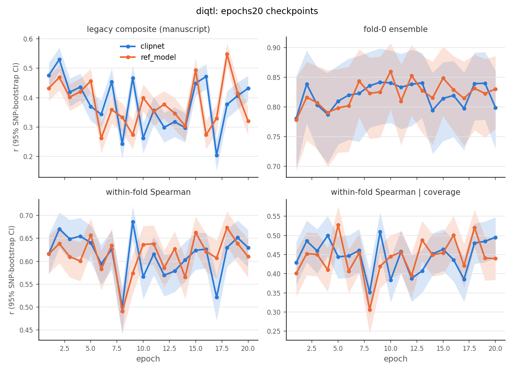
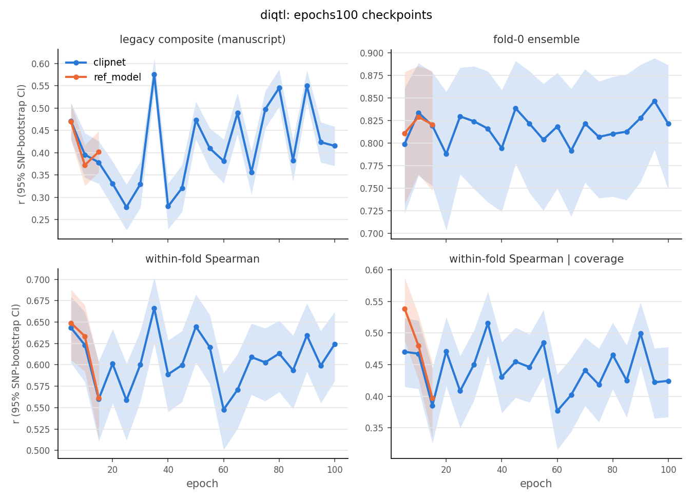
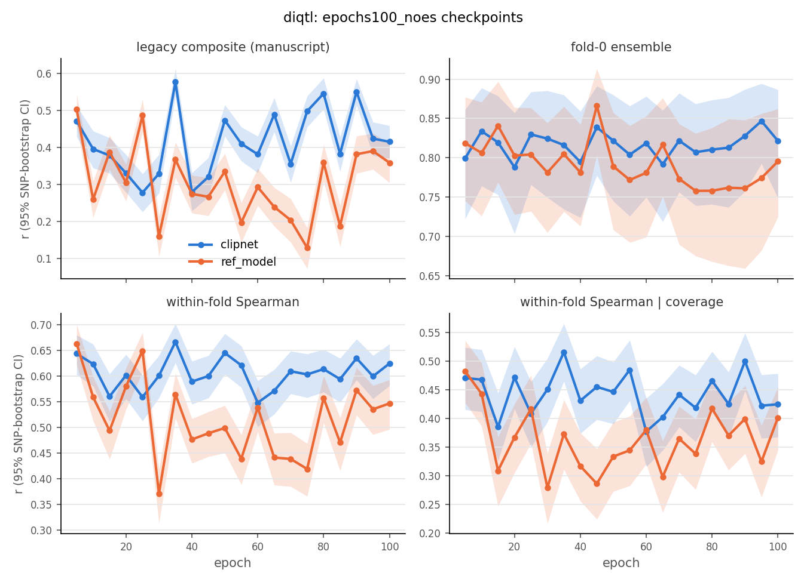
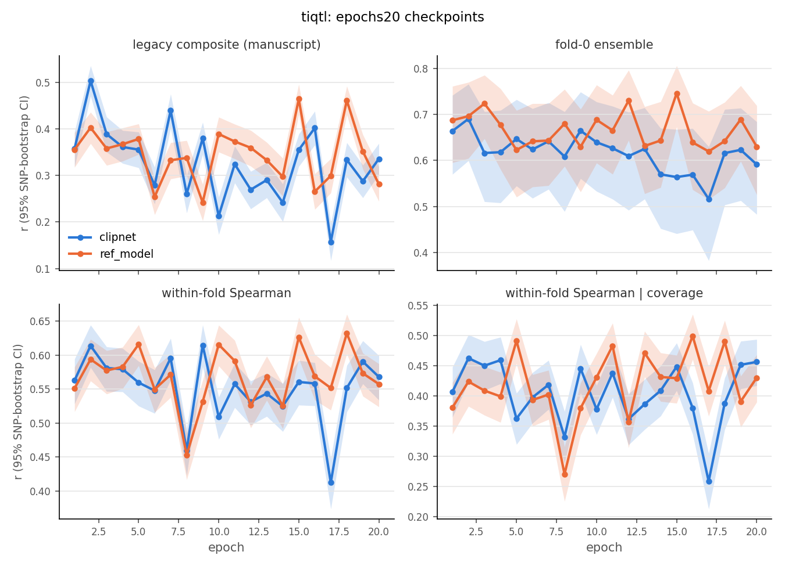
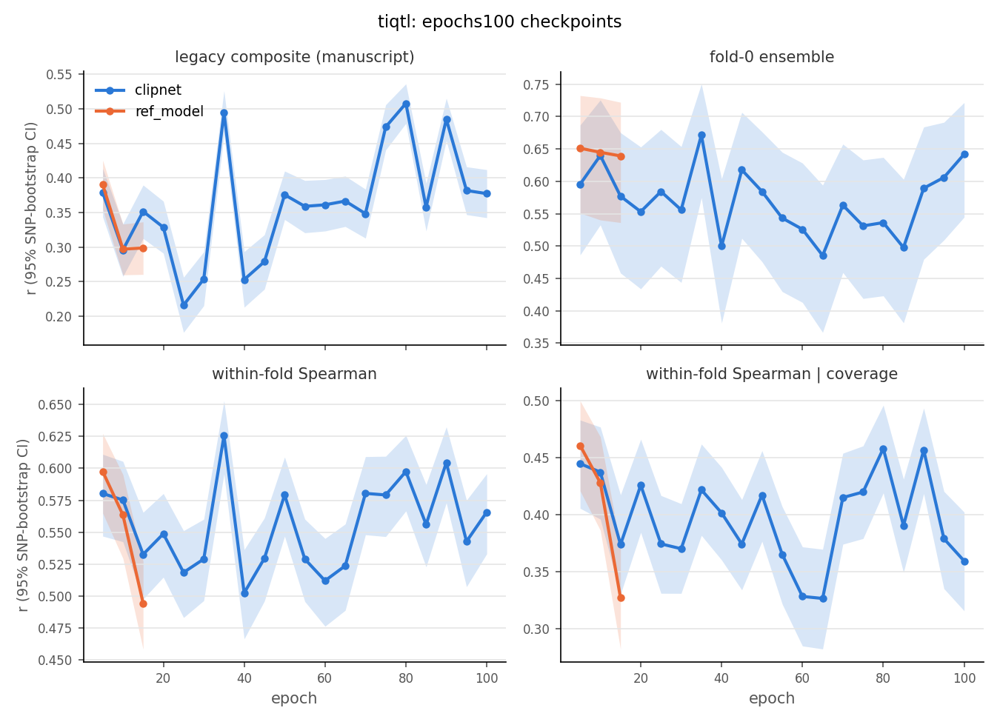
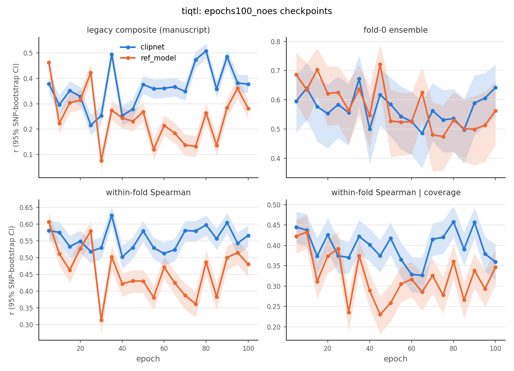

# Non-retraining clipnet vs ref_model QTL analyses

Differences are clipnet - ref_model with 95% paired SNP-bootstrap CIs (SNPs resampled within folds, the same draws for both arms); they do not include training-run noise. `folds_a_higher` counts held-out folds (of 9) where clipnet's fold r is higher (within-fold views only).

- **legacy composite**: the manuscript metric, log-L2 Pearson over SNPs pooled from the 9 held-out folds plus the fold-0 ensemble. Sensitive to differences in count-head calibration between fold models.
- **fold-0 ensemble**: the 9-model ensemble on the fold-0 holdout (171 tiQTL / 77 diQTL SNPs), as CLIPNET is used.
- **within-fold Spearman** (and `| coverage`, with log observed coverage regressed out within each fold): calibration-robust.

`mean_over_epochs` averages each arm's score over all shared epochs; `window_e*` scores an ensemble of the allele-mean tracks over that epoch range.

## Headline comparisons

| qtl | set | view | checkpoint | clipnet | ref_model | diff | ci_low | ci_high | p_boot | folds_a_higher |
|---|---|---|---|---|---|---|---|---|---|---|
| diqtl | best_model | legacy composite (manuscript) | best_model | 0.486 | 0.422 | 0.064 | 0.011 | 0.117 | 0.016 | 3.000 |
| diqtl | best_model | fold-0 ensemble | best_model | 0.794 | 0.817 | -0.023 | -0.069 | 0.019 | 0.290 | 3.000 |
| diqtl | best_model | within-fold Spearman | best_model | 0.565 | 0.624 | -0.059 | -0.103 | -0.017 | 0.005 | 3.000 |
| diqtl | best_model | within-fold Spearman | coverage | best_model | 0.438 | 0.507 | -0.069 | -0.120 | -0.016 | 0.009 | 3.000 |
| diqtl | epochs100 | legacy composite (manuscript) | mean_over_epochs | 0.415 | 0.415 | 0.000 | -0.027 | 0.027 | 0.982 | nan |
| diqtl | epochs100 | fold-0 ensemble | mean_over_epochs | 0.818 | 0.820 | -0.003 | -0.027 | 0.020 | 0.794 | nan |
| diqtl | epochs100 | within-fold Spearman | mean_over_epochs | 0.609 | 0.615 | -0.006 | -0.031 | 0.020 | 0.659 | nan |
| diqtl | epochs100 | within-fold Spearman | coverage | mean_over_epochs | 0.441 | 0.472 | -0.031 | -0.066 | 0.005 | 0.087 | nan |
| diqtl | epochs100 | legacy composite (manuscript) | window_e005-e015 | 0.639 | 0.527 | 0.113 | 0.074 | 0.152 | 0.000 | 4.000 |
| diqtl | epochs100 | fold-0 ensemble | window_e005-e015 | 0.821 | 0.822 | -0.001 | -0.029 | 0.027 | 0.898 | 4.000 |
| diqtl | epochs100 | within-fold Spearman | window_e005-e015 | 0.639 | 0.666 | -0.026 | -0.055 | 0.003 | 0.079 | 4.000 |
| diqtl | epochs100 | within-fold Spearman | coverage | window_e005-e015 | 0.528 | 0.560 | -0.032 | -0.071 | 0.008 | 0.116 | 3.000 |
| diqtl | epochs100_noes | legacy composite (manuscript) | mean_over_epochs | 0.414 | 0.304 | 0.110 | 0.092 | 0.128 | 0.000 | nan |
| diqtl | epochs100_noes | fold-0 ensemble | mean_over_epochs | 0.816 | 0.792 | 0.024 | -0.003 | 0.053 | 0.081 | nan |
| diqtl | epochs100_noes | within-fold Spearman | mean_over_epochs | 0.605 | 0.515 | 0.090 | 0.070 | 0.112 | 0.000 | nan |
| diqtl | epochs100_noes | within-fold Spearman | coverage | mean_over_epochs | 0.443 | 0.362 | 0.081 | 0.054 | 0.107 | 0.000 | nan |
| diqtl | epochs100_noes | legacy composite (manuscript) | window_e005-e015 | 0.639 | 0.652 | -0.013 | -0.041 | 0.015 | 0.373 | 3.000 |
| diqtl | epochs100_noes | fold-0 ensemble | window_e005-e015 | 0.821 | 0.823 | -0.002 | -0.024 | 0.023 | 0.861 | 3.000 |
| diqtl | epochs100_noes | within-fold Spearman | window_e005-e015 | 0.639 | 0.681 | -0.041 | -0.071 | -0.012 | 0.008 | 3.000 |
| diqtl | epochs100_noes | within-fold Spearman | coverage | window_e005-e015 | 0.528 | 0.563 | -0.035 | -0.074 | 0.004 | 0.079 | 2.000 |
| diqtl | epochs100_noes | legacy composite (manuscript) | window_e005-e025 | 0.566 | 0.639 | -0.073 | -0.105 | -0.041 | 0.000 | 1.000 |
| diqtl | epochs100_noes | fold-0 ensemble | window_e005-e025 | 0.815 | 0.812 | 0.003 | -0.019 | 0.029 | 0.825 | 1.000 |
| diqtl | epochs100_noes | within-fold Spearman | window_e005-e025 | 0.628 | 0.692 | -0.064 | -0.092 | -0.037 | 0.000 | 1.000 |
| diqtl | epochs100_noes | within-fold Spearman | coverage | window_e005-e025 | 0.538 | 0.574 | -0.036 | -0.074 | 0.000 | 0.052 | 2.000 |
| diqtl | epochs100_noes | legacy composite (manuscript) | window_e005-e100 | 0.569 | 0.536 | 0.033 | 0.002 | 0.065 | 0.037 | 6.000 |
| diqtl | epochs100_noes | fold-0 ensemble | window_e005-e100 | 0.821 | 0.797 | 0.024 | -0.010 | 0.060 | 0.177 | 6.000 |
| diqtl | epochs100_noes | within-fold Spearman | window_e005-e100 | 0.622 | 0.552 | 0.070 | 0.035 | 0.105 | 0.000 | 6.000 |
| diqtl | epochs100_noes | within-fold Spearman | coverage | window_e005-e100 | 0.511 | 0.492 | 0.019 | -0.021 | 0.058 | 0.346 | 7.000 |
| diqtl | epochs100_noes | legacy composite (manuscript) | window_e030-e050 | 0.557 | 0.540 | 0.017 | -0.018 | 0.052 | 0.345 | 6.000 |
| diqtl | epochs100_noes | fold-0 ensemble | window_e030-e050 | 0.820 | 0.810 | 0.010 | -0.026 | 0.049 | 0.564 | 6.000 |
| diqtl | epochs100_noes | within-fold Spearman | window_e030-e050 | 0.656 | 0.566 | 0.090 | 0.051 | 0.129 | 0.000 | 6.000 |
| diqtl | epochs100_noes | within-fold Spearman | coverage | window_e030-e050 | 0.531 | 0.489 | 0.042 | -0.001 | 0.084 | 0.059 | 6.000 |
| diqtl | epochs100_noes | legacy composite (manuscript) | window_e055-e075 | 0.545 | 0.466 | 0.079 | 0.032 | 0.125 | 0.001 | 7.000 |
| diqtl | epochs100_noes | fold-0 ensemble | window_e055-e075 | 0.815 | 0.781 | 0.033 | -0.008 | 0.082 | 0.116 | 7.000 |
| diqtl | epochs100_noes | within-fold Spearman | window_e055-e075 | 0.570 | 0.488 | 0.082 | 0.037 | 0.126 | 0.000 | 7.000 |
| diqtl | epochs100_noes | within-fold Spearman | coverage | window_e055-e075 | 0.458 | 0.440 | 0.018 | -0.030 | 0.066 | 0.481 | 7.000 |
| diqtl | epochs100_noes | legacy composite (manuscript) | window_e080-e100 | 0.517 | 0.427 | 0.090 | 0.037 | 0.150 | 0.001 | 6.000 |
| diqtl | epochs100_noes | fold-0 ensemble | window_e080-e100 | 0.828 | 0.780 | 0.048 | 0.009 | 0.090 | 0.013 | 6.000 |
| diqtl | epochs100_noes | within-fold Spearman | window_e080-e100 | 0.609 | 0.509 | 0.100 | 0.057 | 0.144 | 0.000 | 6.000 |
| diqtl | epochs100_noes | within-fold Spearman | coverage | window_e080-e100 | 0.471 | 0.439 | 0.032 | -0.016 | 0.081 | 0.202 | 6.000 |
| diqtl | epochs20 | legacy composite (manuscript) | mean_over_epochs | 0.380 | 0.378 | 0.002 | -0.015 | 0.020 | 0.806 | nan |
| diqtl | epochs20 | fold-0 ensemble | mean_over_epochs | 0.820 | 0.821 | -0.001 | -0.020 | 0.021 | 0.896 | nan |
| diqtl | epochs20 | within-fold Spearman | mean_over_epochs | 0.613 | 0.614 | -0.001 | -0.016 | 0.014 | 0.887 | nan |
| diqtl | epochs20 | within-fold Spearman | coverage | mean_over_epochs | 0.446 | 0.442 | 0.004 | -0.016 | 0.024 | 0.691 | nan |
| diqtl | epochs20 | legacy composite (manuscript) | window_e001-e005 | 0.645 | 0.602 | 0.043 | 0.015 | 0.072 | 0.001 | 7.000 |
| diqtl | epochs20 | fold-0 ensemble | window_e001-e005 | 0.812 | 0.805 | 0.007 | -0.019 | 0.037 | 0.615 | 7.000 |
| diqtl | epochs20 | within-fold Spearman | window_e001-e005 | 0.681 | 0.657 | 0.024 | -0.002 | 0.051 | 0.073 | 7.000 |
| diqtl | epochs20 | within-fold Spearman | coverage | window_e001-e005 | 0.575 | 0.551 | 0.023 | -0.009 | 0.056 | 0.153 | 5.000 |
| diqtl | epochs20 | legacy composite (manuscript) | window_e001-e020 | 0.634 | 0.615 | 0.019 | -0.004 | 0.042 | 0.101 | 2.000 |
| diqtl | epochs20 | fold-0 ensemble | window_e001-e020 | 0.825 | 0.829 | -0.004 | -0.022 | 0.017 | 0.700 | 2.000 |
| diqtl | epochs20 | within-fold Spearman | window_e001-e020 | 0.652 | 0.655 | -0.002 | -0.027 | 0.023 | 0.851 | 2.000 |
| diqtl | epochs20 | within-fold Spearman | coverage | window_e001-e020 | 0.578 | 0.570 | 0.008 | -0.023 | 0.039 | 0.626 | 5.000 |
| diqtl | epochs20 | legacy composite (manuscript) | window_e006-e010 | 0.603 | 0.538 | 0.066 | 0.034 | 0.097 | 0.000 | 7.000 |
| diqtl | epochs20 | fold-0 ensemble | window_e006-e010 | 0.838 | 0.836 | 0.001 | -0.027 | 0.032 | 0.904 | 7.000 |
| diqtl | epochs20 | within-fold Spearman | window_e006-e010 | 0.659 | 0.631 | 0.028 | -0.004 | 0.060 | 0.085 | 7.000 |
| diqtl | epochs20 | within-fold Spearman | coverage | window_e006-e010 | 0.573 | 0.544 | 0.028 | -0.010 | 0.067 | 0.144 | 6.000 |
| diqtl | epochs20 | legacy composite (manuscript) | window_e011-e015 | 0.611 | 0.610 | 0.001 | -0.027 | 0.031 | 0.905 | 3.000 |
| diqtl | epochs20 | fold-0 ensemble | window_e011-e015 | 0.825 | 0.830 | -0.005 | -0.030 | 0.022 | 0.731 | 3.000 |
| diqtl | epochs20 | within-fold Spearman | window_e011-e015 | 0.643 | 0.672 | -0.029 | -0.061 | 0.003 | 0.076 | 3.000 |
| diqtl | epochs20 | within-fold Spearman | coverage | window_e011-e015 | 0.543 | 0.563 | -0.020 | -0.059 | 0.020 | 0.334 | 3.000 |
| diqtl | epochs20 | legacy composite (manuscript) | window_e016-e020 | 0.543 | 0.611 | -0.068 | -0.101 | -0.034 | 0.000 | 2.000 |
| diqtl | epochs20 | fold-0 ensemble | window_e016-e020 | 0.821 | 0.831 | -0.010 | -0.030 | 0.013 | 0.410 | 2.000 |
| diqtl | epochs20 | within-fold Spearman | window_e016-e020 | 0.621 | 0.650 | -0.029 | -0.062 | 0.005 | 0.096 | 2.000 |
| diqtl | epochs20 | within-fold Spearman | coverage | window_e016-e020 | 0.535 | 0.545 | -0.010 | -0.047 | 0.029 | 0.631 | 3.000 |
| diqtl | main | legacy composite (manuscript) | published_model | 0.531 | 0.419 | 0.112 | 0.059 | 0.167 | 0.000 | 4.000 |
| diqtl | main | fold-0 ensemble | published_model | 0.811 | 0.799 | 0.011 | -0.035 | 0.061 | 0.631 | 4.000 |
| diqtl | main | within-fold Spearman | published_model | 0.606 | 0.564 | 0.042 | -0.001 | 0.084 | 0.057 | 4.000 |
| diqtl | main | within-fold Spearman | coverage | published_model | 0.504 | 0.433 | 0.071 | 0.017 | 0.123 | 0.007 | 7.000 |
| tiqtl | best_model | legacy composite (manuscript) | best_model | 0.448 | 0.373 | 0.075 | 0.029 | 0.121 | 0.001 | 3.000 |
| tiqtl | best_model | fold-0 ensemble | best_model | 0.538 | 0.645 | -0.107 | -0.159 | -0.057 | 0.000 | 3.000 |
| tiqtl | best_model | within-fold Spearman | best_model | 0.508 | 0.548 | -0.040 | -0.076 | -0.002 | 0.035 | 3.000 |
| tiqtl | best_model | within-fold Spearman | coverage | best_model | 0.394 | 0.404 | -0.010 | -0.054 | 0.035 | 0.651 | 4.000 |
| tiqtl | epochs100 | legacy composite (manuscript) | mean_over_epochs | 0.342 | 0.329 | 0.013 | -0.008 | 0.036 | 0.217 | nan |
| tiqtl | epochs100 | fold-0 ensemble | mean_over_epochs | 0.604 | 0.645 | -0.041 | -0.068 | -0.015 | 0.002 | nan |
| tiqtl | epochs100 | within-fold Spearman | mean_over_epochs | 0.563 | 0.552 | 0.011 | -0.011 | 0.033 | 0.317 | nan |
| tiqtl | epochs100 | within-fold Spearman | coverage | mean_over_epochs | 0.419 | 0.405 | 0.013 | -0.015 | 0.041 | 0.340 | nan |
| tiqtl | epochs100 | legacy composite (manuscript) | window_e005-e015 | 0.582 | 0.460 | 0.123 | 0.091 | 0.154 | 0.000 | 5.000 |
| tiqtl | epochs100 | fold-0 ensemble | window_e005-e015 | 0.598 | 0.647 | -0.049 | -0.081 | -0.018 | 0.002 | 5.000 |
| tiqtl | epochs100 | within-fold Spearman | window_e005-e015 | 0.606 | 0.622 | -0.016 | -0.043 | 0.011 | 0.246 | 5.000 |
| tiqtl | epochs100 | within-fold Spearman | coverage | window_e005-e015 | 0.529 | 0.521 | 0.009 | -0.023 | 0.040 | 0.597 | 7.000 |
| tiqtl | epochs100_noes | legacy composite (manuscript) | mean_over_epochs | 0.362 | 0.247 | 0.115 | 0.103 | 0.128 | 0.000 | nan |
| tiqtl | epochs100_noes | fold-0 ensemble | mean_over_epochs | 0.570 | 0.575 | -0.005 | -0.031 | 0.021 | 0.701 | nan |
| tiqtl | epochs100_noes | within-fold Spearman | mean_over_epochs | 0.556 | 0.459 | 0.097 | 0.082 | 0.113 | 0.000 | nan |
| tiqtl | epochs100_noes | within-fold Spearman | coverage | mean_over_epochs | 0.397 | 0.322 | 0.075 | 0.055 | 0.096 | 0.000 | nan |
| tiqtl | epochs100_noes | legacy composite (manuscript) | window_e005-e015 | 0.582 | 0.589 | -0.007 | -0.032 | 0.018 | 0.583 | 5.000 |
| tiqtl | epochs100_noes | fold-0 ensemble | window_e005-e015 | 0.598 | 0.661 | -0.063 | -0.094 | -0.034 | 0.000 | 5.000 |
| tiqtl | epochs100_noes | within-fold Spearman | window_e005-e015 | 0.606 | 0.621 | -0.015 | -0.040 | 0.010 | 0.233 | 5.000 |
| tiqtl | epochs100_noes | within-fold Spearman | coverage | window_e005-e015 | 0.529 | 0.538 | -0.009 | -0.037 | 0.020 | 0.553 | 4.000 |
| tiqtl | epochs100_noes | legacy composite (manuscript) | window_e005-e025 | 0.533 | 0.589 | -0.056 | -0.083 | -0.030 | 0.000 | 4.000 |
| tiqtl | epochs100_noes | fold-0 ensemble | window_e005-e025 | 0.583 | 0.640 | -0.058 | -0.085 | -0.032 | 0.000 | 4.000 |
| tiqtl | epochs100_noes | within-fold Spearman | window_e005-e025 | 0.595 | 0.625 | -0.030 | -0.055 | -0.005 | 0.019 | 4.000 |
| tiqtl | epochs100_noes | within-fold Spearman | coverage | window_e005-e025 | 0.534 | 0.542 | -0.007 | -0.035 | 0.021 | 0.597 | 4.000 |
| tiqtl | epochs100_noes | legacy composite (manuscript) | window_e005-e100 | 0.527 | 0.461 | 0.066 | 0.041 | 0.092 | 0.000 | 6.000 |
| tiqtl | epochs100_noes | fold-0 ensemble | window_e005-e100 | 0.559 | 0.556 | 0.003 | -0.030 | 0.037 | 0.862 | 6.000 |
| tiqtl | epochs100_noes | within-fold Spearman | window_e005-e100 | 0.572 | 0.480 | 0.092 | 0.062 | 0.120 | 0.000 | 6.000 |
| tiqtl | epochs100_noes | within-fold Spearman | coverage | window_e005-e100 | 0.487 | 0.424 | 0.064 | 0.034 | 0.094 | 0.000 | 7.000 |
| tiqtl | epochs100_noes | legacy composite (manuscript) | window_e030-e050 | 0.488 | 0.459 | 0.029 | -0.011 | 0.065 | 0.141 | 6.000 |
| tiqtl | epochs100_noes | fold-0 ensemble | window_e030-e050 | 0.570 | 0.586 | -0.016 | -0.049 | 0.017 | 0.346 | 6.000 |
| tiqtl | epochs100_noes | within-fold Spearman | window_e030-e050 | 0.588 | 0.504 | 0.084 | 0.052 | 0.116 | 0.000 | 6.000 |
| tiqtl | epochs100_noes | within-fold Spearman | coverage | window_e030-e050 | 0.485 | 0.444 | 0.042 | 0.008 | 0.076 | 0.016 | 4.000 |
| tiqtl | epochs100_noes | legacy composite (manuscript) | window_e055-e075 | 0.497 | 0.388 | 0.109 | 0.074 | 0.144 | 0.000 | 6.000 |
| tiqtl | epochs100_noes | fold-0 ensemble | window_e055-e075 | 0.527 | 0.511 | 0.015 | -0.020 | 0.053 | 0.387 | 6.000 |
| tiqtl | epochs100_noes | within-fold Spearman | window_e055-e075 | 0.524 | 0.410 | 0.115 | 0.081 | 0.148 | 0.000 | 6.000 |
| tiqtl | epochs100_noes | within-fold Spearman | coverage | window_e055-e075 | 0.423 | 0.365 | 0.058 | 0.023 | 0.093 | 0.001 | 8.000 |
| tiqtl | epochs100_noes | legacy composite (manuscript) | window_e080-e100 | 0.469 | 0.383 | 0.087 | 0.053 | 0.122 | 0.000 | 6.000 |
| tiqtl | epochs100_noes | fold-0 ensemble | window_e080-e100 | 0.561 | 0.528 | 0.034 | -0.014 | 0.087 | 0.173 | 6.000 |
| tiqtl | epochs100_noes | within-fold Spearman | window_e080-e100 | 0.562 | 0.468 | 0.094 | 0.060 | 0.127 | 0.000 | 6.000 |
| tiqtl | epochs100_noes | within-fold Spearman | coverage | window_e080-e100 | 0.441 | 0.380 | 0.061 | 0.025 | 0.096 | 0.001 | 7.000 |
| tiqtl | epochs20 | legacy composite (manuscript) | mean_over_epochs | 0.327 | 0.345 | -0.018 | -0.033 | -0.004 | 0.016 | nan |
| tiqtl | epochs20 | fold-0 ensemble | mean_over_epochs | 0.616 | 0.666 | -0.050 | -0.080 | -0.026 | 0.000 | nan |
| tiqtl | epochs20 | within-fold Spearman | mean_over_epochs | 0.551 | 0.568 | -0.017 | -0.030 | -0.004 | 0.014 | nan |
| tiqtl | epochs20 | within-fold Spearman | coverage | mean_over_epochs | 0.405 | 0.419 | -0.014 | -0.030 | 0.002 | 0.084 | nan |
| tiqtl | epochs20 | legacy composite (manuscript) | window_e001-e005 | 0.590 | 0.576 | 0.013 | -0.010 | 0.036 | 0.260 | 6.000 |
| tiqtl | epochs20 | fold-0 ensemble | window_e001-e005 | 0.636 | 0.670 | -0.034 | -0.064 | -0.008 | 0.008 | 6.000 |
| tiqtl | epochs20 | within-fold Spearman | window_e001-e005 | 0.612 | 0.627 | -0.014 | -0.037 | 0.009 | 0.226 | 6.000 |
| tiqtl | epochs20 | within-fold Spearman | coverage | window_e001-e005 | 0.526 | 0.535 | -0.009 | -0.035 | 0.016 | 0.474 | 5.000 |
| tiqtl | epochs20 | legacy composite (manuscript) | window_e001-e020 | 0.562 | 0.587 | -0.026 | -0.044 | -0.007 | 0.008 | 1.000 |
| tiqtl | epochs20 | fold-0 ensemble | window_e001-e020 | 0.602 | 0.658 | -0.056 | -0.095 | -0.026 | 0.000 | 1.000 |
| tiqtl | epochs20 | within-fold Spearman | window_e001-e020 | 0.592 | 0.624 | -0.032 | -0.053 | -0.011 | 0.003 | 1.000 |
| tiqtl | epochs20 | within-fold Spearman | coverage | window_e001-e020 | 0.531 | 0.564 | -0.033 | -0.055 | -0.010 | 0.005 | 1.000 |
| tiqtl | epochs20 | legacy composite (manuscript) | window_e006-e010 | 0.530 | 0.517 | 0.013 | -0.016 | 0.042 | 0.361 | 6.000 |
| tiqtl | epochs20 | fold-0 ensemble | window_e006-e010 | 0.632 | 0.650 | -0.018 | -0.056 | 0.012 | 0.269 | 6.000 |
| tiqtl | epochs20 | within-fold Spearman | window_e006-e010 | 0.615 | 0.603 | 0.012 | -0.012 | 0.036 | 0.341 | 6.000 |
| tiqtl | epochs20 | within-fold Spearman | coverage | window_e006-e010 | 0.546 | 0.525 | 0.020 | -0.008 | 0.049 | 0.168 | 6.000 |
| tiqtl | epochs20 | legacy composite (manuscript) | window_e011-e015 | 0.516 | 0.584 | -0.069 | -0.095 | -0.042 | 0.000 | 2.000 |
| tiqtl | epochs20 | fold-0 ensemble | window_e011-e015 | 0.586 | 0.671 | -0.085 | -0.137 | -0.043 | 0.000 | 2.000 |
| tiqtl | epochs20 | within-fold Spearman | window_e011-e015 | 0.581 | 0.624 | -0.043 | -0.069 | -0.017 | 0.002 | 2.000 |
| tiqtl | epochs20 | within-fold Spearman | coverage | window_e011-e015 | 0.517 | 0.552 | -0.034 | -0.064 | -0.005 | 0.018 | 2.000 |
| tiqtl | epochs20 | legacy composite (manuscript) | window_e016-e020 | 0.485 | 0.558 | -0.072 | -0.099 | -0.046 | 0.000 | 1.000 |
| tiqtl | epochs20 | fold-0 ensemble | window_e016-e020 | 0.578 | 0.639 | -0.060 | -0.094 | -0.029 | 0.000 | 1.000 |
| tiqtl | epochs20 | within-fold Spearman | window_e016-e020 | 0.554 | 0.611 | -0.057 | -0.085 | -0.029 | 0.000 | 1.000 |
| tiqtl | epochs20 | within-fold Spearman | coverage | window_e016-e020 | 0.488 | 0.555 | -0.067 | -0.098 | -0.035 | 0.000 | 1.000 |
| tiqtl | main | legacy composite (manuscript) | published_model | 0.460 | 0.372 | 0.087 | 0.044 | 0.132 | 0.000 | 5.000 |
| tiqtl | main | fold-0 ensemble | published_model | 0.553 | 0.550 | 0.004 | -0.044 | 0.054 | 0.859 | 5.000 |
| tiqtl | main | within-fold Spearman | published_model | 0.511 | 0.484 | 0.027 | -0.010 | 0.063 | 0.161 | 5.000 |
| tiqtl | main | within-fold Spearman | coverage | published_model | 0.438 | 0.365 | 0.073 | 0.032 | 0.114 | 0.000 | 6.000 |

## Diagnostics

| qtl | set | view | checkpoint | clipnet | ref_model | diff | ci_low | ci_high | p_boot | folds_a_higher |
|---|---|---|---|---|---|---|---|---|---|---|
| diqtl | best_model | within-fold Pearson | best_model | 0.533 | 0.627 | -0.094 | -0.136 | -0.049 | 0.000 | 3.000 |
| diqtl | best_model | shape-only (within-fold Pearson) | best_model | 0.321 | 0.250 | 0.071 | 0.018 | 0.124 | 0.010 | 6.000 |
| diqtl | best_model | expression-only baseline | best_model | 0.684 | 0.691 | -0.007 | -0.034 | 0.018 | 0.567 | 4.000 |
| diqtl | epochs100 | within-fold Pearson | mean_over_epochs | 0.602 | 0.616 | -0.014 | -0.040 | 0.015 | 0.390 | nan |
| diqtl | epochs100 | shape-only (within-fold Pearson) | mean_over_epochs | 0.218 | 0.229 | -0.011 | -0.043 | 0.020 | 0.475 | nan |
| diqtl | epochs100 | expression-only baseline | mean_over_epochs | 0.650 | 0.645 | 0.004 | -0.017 | 0.026 | 0.669 | nan |
| diqtl | epochs100 | within-fold Pearson | window_e005-e015 | 0.642 | 0.665 | -0.024 | -0.051 | 0.004 | 0.089 | 4.000 |
| diqtl | epochs100 | shape-only (within-fold Pearson) | window_e005-e015 | 0.234 | 0.238 | -0.004 | -0.040 | 0.031 | 0.802 | 3.000 |
| diqtl | epochs100 | expression-only baseline | window_e005-e015 | 0.714 | 0.695 | 0.019 | -0.004 | 0.039 | 0.099 | 6.000 |
| diqtl | epochs100_noes | within-fold Pearson | mean_over_epochs | 0.593 | 0.500 | 0.093 | 0.069 | 0.117 | 0.000 | nan |
| diqtl | epochs100_noes | shape-only (within-fold Pearson) | mean_over_epochs | 0.293 | 0.266 | 0.026 | -0.005 | 0.060 | 0.104 | nan |
| diqtl | epochs100_noes | expression-only baseline | mean_over_epochs | 0.668 | 0.605 | 0.063 | 0.050 | 0.080 | 0.000 | nan |
| diqtl | epochs100_noes | within-fold Pearson | window_e005-e015 | 0.642 | 0.677 | -0.035 | -0.061 | -0.008 | 0.010 | 3.000 |
| diqtl | epochs100_noes | shape-only (within-fold Pearson) | window_e005-e015 | 0.234 | 0.202 | 0.032 | -0.009 | 0.076 | 0.123 | 6.000 |
| diqtl | epochs100_noes | expression-only baseline | window_e005-e015 | 0.714 | 0.721 | -0.006 | -0.024 | 0.012 | 0.493 | 4.000 |
| diqtl | epochs100_noes | within-fold Pearson | window_e005-e025 | 0.627 | 0.688 | -0.061 | -0.085 | -0.035 | 0.000 | 1.000 |
| diqtl | epochs100_noes | shape-only (within-fold Pearson) | window_e005-e025 | 0.270 | 0.208 | 0.061 | 0.022 | 0.102 | 0.002 | 7.000 |
| diqtl | epochs100_noes | expression-only baseline | window_e005-e025 | 0.716 | 0.725 | -0.009 | -0.026 | 0.008 | 0.299 | 4.000 |
| diqtl | epochs100_noes | within-fold Pearson | window_e005-e100 | 0.617 | 0.555 | 0.062 | 0.031 | 0.094 | 0.000 | 6.000 |
| diqtl | epochs100_noes | shape-only (within-fold Pearson) | window_e005-e100 | 0.338 | 0.307 | 0.031 | -0.010 | 0.073 | 0.133 | 6.000 |
| diqtl | epochs100_noes | expression-only baseline | window_e005-e100 | 0.738 | 0.722 | 0.016 | 0.002 | 0.031 | 0.025 | 7.000 |
| diqtl | epochs100_noes | within-fold Pearson | window_e030-e050 | 0.647 | 0.571 | 0.077 | 0.042 | 0.113 | 0.000 | 6.000 |
| diqtl | epochs100_noes | shape-only (within-fold Pearson) | window_e030-e050 | 0.333 | 0.253 | 0.080 | 0.032 | 0.129 | 0.001 | 8.000 |
| diqtl | epochs100_noes | expression-only baseline | window_e030-e050 | 0.738 | 0.699 | 0.039 | 0.022 | 0.057 | 0.000 | 7.000 |
| diqtl | epochs100_noes | within-fold Pearson | window_e055-e075 | 0.569 | 0.485 | 0.084 | 0.042 | 0.126 | 0.000 | 7.000 |
| diqtl | epochs100_noes | shape-only (within-fold Pearson) | window_e055-e075 | 0.345 | 0.313 | 0.032 | -0.013 | 0.078 | 0.163 | 6.000 |
| diqtl | epochs100_noes | expression-only baseline | window_e055-e075 | 0.731 | 0.709 | 0.022 | 0.006 | 0.039 | 0.007 | 8.000 |
| diqtl | epochs100_noes | within-fold Pearson | window_e080-e100 | 0.607 | 0.501 | 0.106 | 0.057 | 0.155 | 0.000 | 6.000 |
| diqtl | epochs100_noes | shape-only (within-fold Pearson) | window_e080-e100 | 0.336 | 0.355 | -0.019 | -0.065 | 0.025 | 0.396 | 3.000 |
| diqtl | epochs100_noes | expression-only baseline | window_e080-e100 | 0.735 | 0.716 | 0.020 | 0.001 | 0.038 | 0.040 | 6.000 |
| diqtl | epochs20 | within-fold Pearson | mean_over_epochs | 0.610 | 0.610 | -0.000 | -0.014 | 0.013 | 0.960 | nan |
| diqtl | epochs20 | shape-only (within-fold Pearson) | mean_over_epochs | 0.222 | 0.227 | -0.004 | -0.030 | 0.022 | 0.748 | nan |
| diqtl | epochs20 | expression-only baseline | mean_over_epochs | 0.636 | 0.634 | 0.002 | -0.011 | 0.015 | 0.790 | nan |
| diqtl | epochs20 | within-fold Pearson | window_e001-e005 | 0.694 | 0.669 | 0.025 | 0.003 | 0.047 | 0.023 | 7.000 |
| diqtl | epochs20 | shape-only (within-fold Pearson) | window_e001-e005 | 0.225 | 0.231 | -0.006 | -0.038 | 0.025 | 0.697 | 3.000 |
| diqtl | epochs20 | expression-only baseline | window_e001-e005 | 0.732 | 0.721 | 0.011 | -0.003 | 0.026 | 0.116 | 6.000 |
| diqtl | epochs20 | within-fold Pearson | window_e001-e020 | 0.660 | 0.671 | -0.011 | -0.033 | 0.013 | 0.385 | 2.000 |
| diqtl | epochs20 | shape-only (within-fold Pearson) | window_e001-e020 | 0.249 | 0.256 | -0.007 | -0.040 | 0.026 | 0.680 | 3.000 |
| diqtl | epochs20 | expression-only baseline | window_e001-e020 | 0.730 | 0.738 | -0.008 | -0.020 | 0.004 | 0.222 | 3.000 |
| diqtl | epochs20 | within-fold Pearson | window_e006-e010 | 0.662 | 0.646 | 0.015 | -0.012 | 0.044 | 0.260 | 7.000 |
| diqtl | epochs20 | shape-only (within-fold Pearson) | window_e006-e010 | 0.221 | 0.250 | -0.029 | -0.068 | 0.011 | 0.153 | 5.000 |
| diqtl | epochs20 | expression-only baseline | window_e006-e010 | 0.718 | 0.721 | -0.003 | -0.019 | 0.014 | 0.782 | 3.000 |
| diqtl | epochs20 | within-fold Pearson | window_e011-e015 | 0.646 | 0.681 | -0.036 | -0.064 | -0.006 | 0.014 | 3.000 |
| diqtl | epochs20 | shape-only (within-fold Pearson) | window_e011-e015 | 0.237 | 0.236 | 0.000 | -0.040 | 0.042 | 0.972 | 4.000 |
| diqtl | epochs20 | expression-only baseline | window_e011-e015 | 0.720 | 0.737 | -0.017 | -0.034 | 0.000 | 0.052 | 3.000 |
| diqtl | epochs20 | within-fold Pearson | window_e016-e020 | 0.619 | 0.659 | -0.041 | -0.070 | -0.009 | 0.013 | 2.000 |
| diqtl | epochs20 | shape-only (within-fold Pearson) | window_e016-e020 | 0.256 | 0.246 | 0.010 | -0.032 | 0.052 | 0.660 | 5.000 |
| diqtl | epochs20 | expression-only baseline | window_e016-e020 | 0.710 | 0.732 | -0.022 | -0.040 | -0.003 | 0.019 | 3.000 |
| diqtl | main | within-fold Pearson | published_model | 0.585 | 0.562 | 0.023 | -0.016 | 0.065 | 0.257 | 4.000 |
| diqtl | main | shape-only (within-fold Pearson) | published_model | 0.341 | 0.300 | 0.041 | -0.004 | 0.088 | 0.078 | 7.000 |
| diqtl | main | expression-only baseline | published_model | 0.730 | 0.702 | 0.028 | 0.007 | 0.052 | 0.010 | 8.000 |
| tiqtl | best_model | within-fold Pearson | best_model | 0.467 | 0.516 | -0.049 | -0.094 | -0.003 | 0.036 | 3.000 |
| tiqtl | best_model | shape-only (within-fold Pearson) | best_model | 0.313 | 0.238 | 0.075 | 0.037 | 0.113 | 0.000 | 7.000 |
| tiqtl | best_model | expression-only baseline | best_model | 0.637 | 0.635 | 0.001 | -0.019 | 0.024 | 0.829 | 6.000 |
| tiqtl | epochs100 | within-fold Pearson | mean_over_epochs | 0.554 | 0.548 | 0.006 | -0.015 | 0.027 | 0.560 | nan |
| tiqtl | epochs100 | shape-only (within-fold Pearson) | mean_over_epochs | 0.185 | 0.185 | 0.000 | -0.024 | 0.024 | 0.989 | nan |
| tiqtl | epochs100 | expression-only baseline | mean_over_epochs | 0.588 | 0.595 | -0.007 | -0.024 | 0.012 | 0.504 | nan |
| tiqtl | epochs100 | within-fold Pearson | window_e005-e015 | 0.604 | 0.616 | -0.013 | -0.037 | 0.012 | 0.318 | 5.000 |
| tiqtl | epochs100 | shape-only (within-fold Pearson) | window_e005-e015 | 0.199 | 0.193 | 0.006 | -0.024 | 0.034 | 0.741 | 5.000 |
| tiqtl | epochs100 | expression-only baseline | window_e005-e015 | 0.661 | 0.666 | -0.005 | -0.020 | 0.009 | 0.475 | 3.000 |
| tiqtl | epochs100_noes | within-fold Pearson | mean_over_epochs | 0.533 | 0.445 | 0.088 | 0.073 | 0.105 | 0.000 | nan |
| tiqtl | epochs100_noes | shape-only (within-fold Pearson) | mean_over_epochs | 0.281 | 0.270 | 0.012 | -0.012 | 0.036 | 0.318 | nan |
| tiqtl | epochs100_noes | expression-only baseline | mean_over_epochs | 0.617 | 0.547 | 0.070 | 0.060 | 0.083 | 0.000 | nan |
| tiqtl | epochs100_noes | within-fold Pearson | window_e005-e015 | 0.604 | 0.617 | -0.013 | -0.036 | 0.010 | 0.274 | 5.000 |
| tiqtl | epochs100_noes | shape-only (within-fold Pearson) | window_e005-e015 | 0.199 | 0.181 | 0.017 | -0.014 | 0.049 | 0.265 | 6.000 |
| tiqtl | epochs100_noes | expression-only baseline | window_e005-e015 | 0.661 | 0.673 | -0.012 | -0.025 | 0.001 | 0.078 | 4.000 |
| tiqtl | epochs100_noes | within-fold Pearson | window_e005-e025 | 0.594 | 0.621 | -0.027 | -0.049 | -0.005 | 0.019 | 4.000 |
| tiqtl | epochs100_noes | shape-only (within-fold Pearson) | window_e005-e025 | 0.229 | 0.186 | 0.043 | 0.014 | 0.073 | 0.004 | 6.000 |
| tiqtl | epochs100_noes | expression-only baseline | window_e005-e025 | 0.668 | 0.677 | -0.009 | -0.021 | 0.003 | 0.144 | 4.000 |
| tiqtl | epochs100_noes | within-fold Pearson | window_e005-e100 | 0.561 | 0.480 | 0.081 | 0.056 | 0.107 | 0.000 | 6.000 |
| tiqtl | epochs100_noes | shape-only (within-fold Pearson) | window_e005-e100 | 0.318 | 0.301 | 0.017 | -0.014 | 0.048 | 0.272 | 5.000 |
| tiqtl | epochs100_noes | expression-only baseline | window_e005-e100 | 0.686 | 0.670 | 0.016 | 0.005 | 0.027 | 0.006 | 6.000 |
| tiqtl | epochs100_noes | within-fold Pearson | window_e030-e050 | 0.563 | 0.507 | 0.056 | 0.023 | 0.092 | 0.001 | 6.000 |
| tiqtl | epochs100_noes | shape-only (within-fold Pearson) | window_e030-e050 | 0.319 | 0.260 | 0.059 | 0.023 | 0.094 | 0.001 | 6.000 |
| tiqtl | epochs100_noes | expression-only baseline | window_e030-e050 | 0.684 | 0.646 | 0.038 | 0.024 | 0.052 | 0.000 | 8.000 |
| tiqtl | epochs100_noes | within-fold Pearson | window_e055-e075 | 0.511 | 0.405 | 0.106 | 0.076 | 0.136 | 0.000 | 6.000 |
| tiqtl | epochs100_noes | shape-only (within-fold Pearson) | window_e055-e075 | 0.325 | 0.326 | -0.000 | -0.034 | 0.033 | 0.999 | 3.000 |
| tiqtl | epochs100_noes | expression-only baseline | window_e055-e075 | 0.676 | 0.659 | 0.017 | 0.004 | 0.030 | 0.011 | 6.000 |
| tiqtl | epochs100_noes | within-fold Pearson | window_e080-e100 | 0.549 | 0.460 | 0.090 | 0.060 | 0.120 | 0.000 | 6.000 |
| tiqtl | epochs100_noes | shape-only (within-fold Pearson) | window_e080-e100 | 0.326 | 0.334 | -0.009 | -0.042 | 0.025 | 0.638 | 5.000 |
| tiqtl | epochs100_noes | expression-only baseline | window_e080-e100 | 0.685 | 0.658 | 0.027 | 0.013 | 0.041 | 0.000 | 8.000 |
| tiqtl | epochs20 | within-fold Pearson | mean_over_epochs | 0.542 | 0.560 | -0.018 | -0.030 | -0.006 | 0.005 | nan |
| tiqtl | epochs20 | shape-only (within-fold Pearson) | mean_over_epochs | 0.198 | 0.205 | -0.008 | -0.027 | 0.011 | 0.411 | nan |
| tiqtl | epochs20 | expression-only baseline | mean_over_epochs | 0.589 | 0.591 | -0.002 | -0.013 | 0.007 | 0.613 | nan |
| tiqtl | epochs20 | within-fold Pearson | window_e001-e005 | 0.617 | 0.625 | -0.008 | -0.028 | 0.011 | 0.415 | 6.000 |
| tiqtl | epochs20 | shape-only (within-fold Pearson) | window_e001-e005 | 0.186 | 0.190 | -0.004 | -0.031 | 0.021 | 0.738 | 3.000 |
| tiqtl | epochs20 | expression-only baseline | window_e001-e005 | 0.683 | 0.683 | -0.000 | -0.011 | 0.011 | 0.950 | 5.000 |
| tiqtl | epochs20 | within-fold Pearson | window_e001-e020 | 0.591 | 0.627 | -0.036 | -0.054 | -0.017 | 0.000 | 1.000 |
| tiqtl | epochs20 | shape-only (within-fold Pearson) | window_e001-e020 | 0.220 | 0.231 | -0.012 | -0.036 | 0.012 | 0.325 | 3.000 |
| tiqtl | epochs20 | expression-only baseline | window_e001-e020 | 0.683 | 0.696 | -0.013 | -0.022 | -0.004 | 0.008 | 3.000 |
| tiqtl | epochs20 | within-fold Pearson | window_e006-e010 | 0.608 | 0.609 | -0.001 | -0.023 | 0.021 | 0.925 | 6.000 |
| tiqtl | epochs20 | shape-only (within-fold Pearson) | window_e006-e010 | 0.192 | 0.205 | -0.013 | -0.043 | 0.015 | 0.371 | 4.000 |
| tiqtl | epochs20 | expression-only baseline | window_e006-e010 | 0.674 | 0.675 | -0.001 | -0.014 | 0.012 | 0.861 | 3.000 |
| tiqtl | epochs20 | within-fold Pearson | window_e011-e015 | 0.578 | 0.622 | -0.044 | -0.068 | -0.020 | 0.001 | 2.000 |
| tiqtl | epochs20 | shape-only (within-fold Pearson) | window_e011-e015 | 0.217 | 0.226 | -0.009 | -0.039 | 0.020 | 0.521 | 4.000 |
| tiqtl | epochs20 | expression-only baseline | window_e011-e015 | 0.677 | 0.693 | -0.016 | -0.029 | -0.003 | 0.014 | 3.000 |
| tiqtl | epochs20 | within-fold Pearson | window_e016-e020 | 0.555 | 0.609 | -0.054 | -0.079 | -0.030 | 0.000 | 1.000 |
| tiqtl | epochs20 | shape-only (within-fold Pearson) | window_e016-e020 | 0.238 | 0.250 | -0.012 | -0.042 | 0.018 | 0.423 | 5.000 |
| tiqtl | epochs20 | expression-only baseline | window_e016-e020 | 0.666 | 0.691 | -0.025 | -0.038 | -0.010 | 0.001 | 2.000 |
| tiqtl | main | within-fold Pearson | published_model | 0.506 | 0.467 | 0.039 | 0.000 | 0.076 | 0.047 | 5.000 |
| tiqtl | main | shape-only (within-fold Pearson) | published_model | 0.338 | 0.269 | 0.069 | 0.031 | 0.107 | 0.000 | 7.000 |
| tiqtl | main | expression-only baseline | published_model | 0.684 | 0.644 | 0.040 | 0.021 | 0.059 | 0.000 | 7.000 |

## Count-head zero clipping

Fraction of held-out SNPs whose predicted L2 is exactly 0 because the ReLU count head outputs 0 for every individual.

| qtl | set | arm | n_checkpoint_folds | mean_frac_zero_l2 | frac_folds_over_half_zero | n_folds_all_zero |
|---|---|---|---|---|---|---|
| diqtl | best_model | clipnet | 9 | 0.017 | 0.000 | 0 |
| diqtl | best_model | ref_model | 9 | 0.179 | 0.222 | 0 |
| diqtl | epochs100 | clipnet | 180 | 0.189 | 0.150 | 2 |
| diqtl | epochs100 | ref_model | 61 | 0.289 | 0.328 | 2 |
| diqtl | epochs100_noes | clipnet | 180 | 0.189 | 0.150 | 2 |
| diqtl | epochs100_noes | ref100_ref_model | 180 | 0.337 | 0.367 | 14 |
| diqtl | epochs20 | clipnet | 180 | 0.271 | 0.283 | 0 |
| diqtl | epochs20 | ref_model | 180 | 0.261 | 0.272 | 5 |
| diqtl | main | clipnet | 9 | 0.003 | 0.000 | 0 |
| diqtl | main | ref_model | 9 | 0.155 | 0.000 | 0 |
| tiqtl | best_model | clipnet | 9 | 0.012 | 0.000 | 0 |
| tiqtl | best_model | ref_model | 9 | 0.188 | 0.222 | 0 |
| tiqtl | epochs100 | clipnet | 180 | 0.217 | 0.206 | 2 |
| tiqtl | epochs100 | ref_model | 61 | 0.323 | 0.393 | 2 |
| tiqtl | epochs100_noes | clipnet | 180 | 0.217 | 0.206 | 2 |
| tiqtl | epochs100_noes | ref100_ref_model | 180 | 0.365 | 0.400 | 13 |
| tiqtl | epochs20 | clipnet | 180 | 0.295 | 0.306 | 2 |
| tiqtl | epochs20 | ref_model | 180 | 0.288 | 0.311 | 5 |
| tiqtl | main | clipnet | 9 | 0.001 | 0.000 | 0 |
| tiqtl | main | ref_model | 9 | 0.169 | 0.111 | 0 |

## Epoch traces

